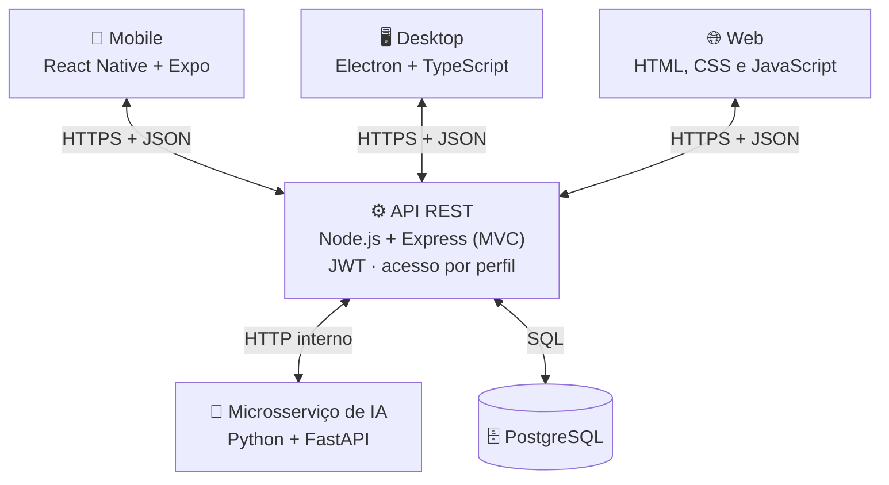

<div align="center">

# 🏕️ Sistema de Gerenciamento do Grupo Escoteiro

**Aplicativo mobile, aplicação desktop e portal web para apoiar a gestão do 455º Grupo Escoteiro Fortaleza de Itaipu**


*Projeto Integrador · Fatec Praia Grande · Desenvolvimento de Software Multiplataforma*

[**🌐 Acessar o portal institucional**](https://escoteirosfortalezaitaipu455.netlify.app/)

</div>

---

## 📖 Sobre o projeto

O Movimento Escoteiro depende de adultos voluntários que organizam jovens, patrulhas, atividades e finanças. No Brasil, o registro das Unidades Escoteiras Locais é feito no sistema PAXTU, uma aplicação web pensada para computadores, o que dificulta o uso em campo, nos acampamentos e atividades ao ar livre.

Este projeto propõe um **sistema multiplataforma**, em que cada interface é adequada ao seu contexto de uso:

| Plataforma | Para quem | Por quê |
|---|---|---|
| 📱 **Mobile** | Escotistas | Gestão de campo: jovens, patrulhas e atividades, direto do celular |
| 🖥️ **Desktop** | Dirigentes | Gestão financeira: mensalidades e fluxo de caixa por ramo |
| 🌐 **Web** | Comunidade | Portal público para divulgar o escotismo e orientar o ingresso |

Todas as aplicações consomem **uma única API**, com acesso controlado por perfil: o módulo financeiro é exclusivo do dirigente.

---

## ✨ Funcionalidades

**📱 Aplicativo mobile (escotistas)**
- Cadastro, edição e consulta de jovens, com estatísticas de desempenho físico, conhecimento técnico e experiência
- Cadastro e consulta das atividades do ramo
- Criação de patrulhas, com inclusão e remoção de jovens
- Avaliação dos jovens
- Painel administrativo: cadastro de novos chefes, com acessos e ramos de atuação, e lista de chefes de seção filtrada por ramo
- **Inteligência artificial:** sugestão de patrulhas equilibradas (algoritmo Fuzzy C-Means) e sugestão de atividades pedagógicas por meio de um modelo de linguagem

**🖥️ Aplicação desktop (dirigentes)**
- Lançamento de mensalidades por jovem, com acompanhamento das pendências por mês
- Lançamento de entradas e saídas de caixa, vinculadas a um ramo (Lobinho, Escoteiro, Sênior, Pioneiro) ou a "Administrativo/Geral"
- Visão geral e relatórios financeiros, com saldo e percentual de adimplência

**🌐 Portal institucional**
- O que é o escotismo, atividades do grupo e os ramos com suas faixas etárias
- Orientações de ingresso para jovens, responsáveis e adultos voluntários
- Menu responsivo, tema claro/escuro e perguntas frequentes

**🔐 Segurança**
- Autenticação por token JWT
- Controle de acesso por perfil (escotista, dirigente e administrador)
- Usuário com perfil de escotista recebe resposta `403` ao tentar acessar dados financeiros

---

## 🖼️ Telas

### 🌐 Portal institucional
Página inicial do portal, publicada em [escoteirosfortalezaitaipu455.netlify.app](https://escoteirosfortalezaitaipu455.netlify.app/).


### 🖥️ Módulo financeiro (web e desktop)
Resumo financeiro do mês, com saldo calculado, entradas, saídas, mensalidades pendentes e movimentações recentes.


### 📱 Aplicativo mobile
Tela inicial do painel administrativo, com o cadastro de novos chefes e a lista de chefes de seção por ramo. A navegação tem as abas Home, Patrulhas, Membros e Perfil.

<p align="center">
  
</p>

---

## 🏗️ Arquitetura



Os clientes falam **somente com a API**. Só a API acessa o banco de dados e o microsserviço de IA, o que permite que o serviço de IA falhe ou seja atualizado sem parar o cadastro e o financeiro. O backend é hospedado no **Render** e o portal no **Netlify**.

---

## 📂 Estrutura do repositório

Cada projeto está em um arquivo `.zip`. Extraia o arquivo para ver o código.

| Arquivo | Conteúdo |
|---|---|
| `AppEscoteiro-main.zip` | Aplicativo mobile (React Native + Expo) |
| `fortaleza-itaipu-gestao-escoteira-main.zip` | Sistema web financeiro, também distribuído como aplicação desktop com Electron |
| `IA_GEFI.zip` | Serviço de inteligência artificial (Python + FastAPI) |
| `Grupo_Escoteiro.zip` | Back-end (API REST em Node.js) |

---

## 🧰 Tecnologias

| Componente | Tecnologias |
|---|---|
| Mobile | React Native 0.81, Expo SDK 54, React 19 |
| Sistema web financeiro | React 19, TypeScript 5.9, Vite, vinext, Node.js 22+ |
| Desktop | O mesmo sistema web, empacotado com Electron |
| Portal | HTML, CSS e JavaScript, publicado no Netlify |
| API | Node.js, padrão MVC |
| Banco de dados | PostgreSQL |
| Inteligência artificial | Python, FastAPI, Fuzzy C-Means, modelo de linguagem |
| Hospedagem | Render (backend e banco) e Netlify (portal) |

---

## ▶️ Como executar

> Antes de começar, extraia o `.zip` do projeto e entre na pasta extraída. Você precisa do **Node.js 22 ou superior** e do **npm**.

**Aplicativo mobile**
```bash
npm install
npx expo start
```
Abra o aplicativo no Expo Go (celular) ou em um emulador.

**Sistema web financeiro**
```bash
npm install
npm run dev
```
A aplicação abre em `http://localhost:3000`.

**Testes automatizados e verificações do sistema web**
```bash
node --test tests/integration.cjs
npx tsc --noEmit
```

Cada projeto pode ter instruções e variáveis de ambiente próprias; consulte o `README` dentro de cada pasta, quando houver. Nunca publique arquivos `.env` nem chaves de acesso.

---

## 🧪 Testes e homologação

O sistema passou por **48 casos de teste** na disciplina *Qualidade e Testes de Software*, executados em 15 e 16/11/2026.

| Resultado | Casos |
|---|---|
| ✅ Passou | 29 |
| ❌ Falhou | 8 |
| 🟡 Parcial | 3 |
| ⛔ Bloqueado | 6 |
| ⏸️ Não executado | 2 |

**Parecer:** aprovado para continuidade da homologação; **ainda não aprovado para produção**. Os principais pontos pendentes são a publicação e validação do backend de produção, o tratamento de alertas de dependências e a validação nativa do aplicativo mobile.

---

## 👥 Equipe

| Integrante | Frente |
|---|---|
| Laura Beatriz Campos | Scrum Master / Product Owner · Web · Documentação |
| Luís Gustavo Texeira Silva | Co-Scrum Master · Back-end e banco de dados |
| Luiz Tadeu Becari Dias da Silva | Mobile |
| Otho Oliver Ribeiro | Desktop |
| Daniel Patricio Barbosa Junior | Web |

**Orientadora:** Prof.ª Eulaliane Aparecida Gonçalves

---

## 🏫 Contexto acadêmico

Projeto Integrador do curso de **Tecnologia em Desenvolvimento de Software Multiplataforma** da **Fatec Praia Grande**, desenvolvido para o **455º Grupo Escoteiro Fortaleza de Itaipu**, em Praia Grande, SP.

🔗 **Portal institucional:** [escoteirosfortalezaitaipu455.netlify.app](https://escoteirosfortalezaitaipu455.netlify.app/)
